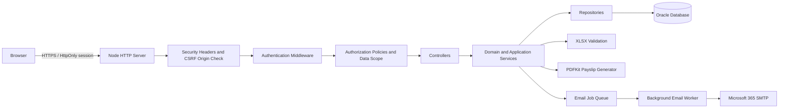
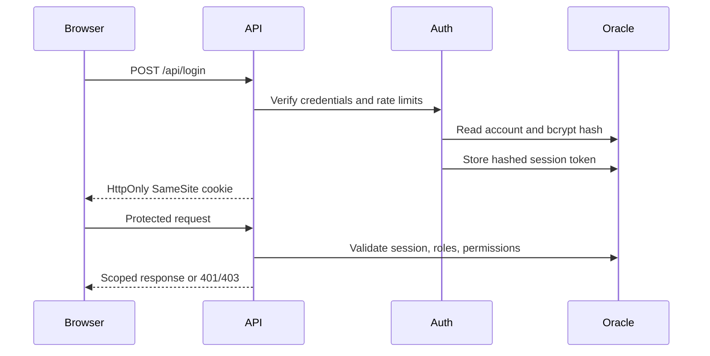
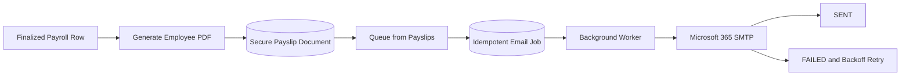

# Inovaantage HRMS and Payroll Portal

[](https://github.com/AnuragNR21/Inovaantage_HRMS/actions/workflows/ci.yml)

Secure employee and payroll operations for Inovaantage Systems Pvt. Ltd. The portal covers employee administration, controlled salary imports, payroll approval and finalization, employee-specific payslips, Microsoft 365 delivery, role-based access control, audit logging, and operational reporting.

> This is a private business application. Never commit production credentials, employee exports, salary files, generated payslips, or database backups.

## Contents

- [Capabilities](#capabilities)
- [Technology stack](#technology-stack)
- [System architecture](#system-architecture)
- [Business flows](#business-flows)
- [Repository structure](#repository-structure)
- [Local setup](#local-setup)
- [Database installation](#database-installation)
- [Email setup](#email-setup)
- [Testing and CI](#testing-and-ci)
- [Security model](#security-model)
- [Operations and deployment](#operations-and-deployment)
- [Troubleshooting](#troubleshooting)

## Capabilities

- Oracle-backed authentication with bcrypt password hashing and opaque, revocable sessions.
- Database-backed roles and permissions with server-side route policies.
- Employee-level isolation for profiles, salary history, and payslips.
- Employee administration and account activation controls.
- Secure `.xlsx` validation, preview, duplicate resolution, and transactional import.
- Multi-file monthly payroll processing with source-file deletion and cleanup.
- Row-level approval, hold, and finalization controls.
- Corporate A4 PDF payslips with masked sensitive identifiers.
- Authorized individual and bulk payslip downloads.
- Background email queue with idempotency, retries, delivery tracking, and hold enforcement.
- Monthly payroll reports with summary and employee-level CSV exports.
- Protected audit trail for security-sensitive and payroll-sensitive operations.
- Responsive frontend with permission-aware navigation and operational states.

## Technology Stack

| Layer | Technology |
|---|---|
| Frontend | HTML5, CSS3, browser JavaScript |
| Backend | Node.js 18+, built-in HTTP server |
| Database | Oracle Database 19c or 21c |
| Database driver | `oracledb` in Thin mode |
| Authentication | bcrypt, Oracle-backed opaque sessions |
| Excel processing | `xlsx` |
| PDF generation | `pdfkit` |
| Email | `nodemailer`, SMTP/STARTTLS, background queue |
| Testing | Node.js test runner |
| CI | GitHub Actions |

Oracle Instant Client is not required for ordinary Thin-mode TCP connections. Configure Thick mode only when required by a wallet or an environment-specific Oracle policy.

## System Architecture



### Responsibility boundaries

| Component | Responsibility |
|---|---|
| `public/` | UI, client-side state, and API integration. It is not a security boundary. |
| `server/router.js` | HTTP route matching after authentication and policy enforcement. |
| `server/authorization/` | Permissions, route policies, and employee data scopes. |
| `server/controllers/` | Request parsing, response mapping, and audit orchestration. |
| `server/services/` | Payroll, import, payslip, email, authentication, and workflow rules. |
| `server/repositories/` | Parameterized Oracle queries and transaction-aware persistence. |
| `server/domain/` | Payroll DTOs, states, transitions, and domain errors. |
| `server/utils/` | Focused HTTP, Excel, PDF, SMTP, and session infrastructure. |
| `sql/` | Baseline schema, seed data, and additive migrations. |

## Business Flows

### Authentication and authorization



### Salary import and payroll processing


Confirmation is all-or-nothing. Invalid workbooks and persistence failures do not leave partial imports. Multiple files can contribute to one period, while duplicate employees require an explicit keep/replace decision.

### Payslip and email delivery



Held rows cannot be downloaded or emailed. Each job binds one employee, payroll row, and generated document. Sent or pending jobs are not duplicated.

### Payroll lifecycle

```text
DRAFT -> PROCESSING -> VALIDATED -> APPROVED -> FINALIZED
                    \-> FAILED

Employee rows may be APPROVED, HOLD, or FINALIZED under the row workflow.
```

## Repository Structure

```text
Inovaantage_HRMS/
|-- .github/workflows/       # Continuous integration
|-- public/                  # Browser UI and static assets
|   |-- assets/              # Company branding
|   |-- css/                 # Shared application styling
|   `-- js/                  # Page and shared frontend logic
|-- scripts/                 # Validation, migrations, bootstrap, SMTP verification
|-- server/
|   |-- assets/              # Server-side document assets
|   |-- authorization/       # RBAC policies and data scopes
|   |-- controllers/         # HTTP request handlers
|   |-- domain/payroll/      # Payroll states, DTOs, and errors
|   |-- repositories/        # Oracle persistence
|   |-- services/            # Business and application services
|   |-- utils/               # HTTP, session, Excel, PDF, and mail helpers
|   |-- config.js            # Environment configuration
|   |-- db.js                # Oracle pool management
|   |-- router.js            # API routing
|   `-- server.js            # Application entry point
|-- sql/                     # Schema, seed data, and ordered migrations
|-- test/                    # Unit, integration, security, and journey tests
|-- .env.example             # Secret-free configuration template
|-- EMAIL_SETUP.md           # Microsoft 365 SMTP runbook
|-- package.json
`-- README.md
```

## Local Setup

### Prerequisites

- Node.js 18 or newer; Node.js 20 LTS is recommended.
- npm.
- Oracle Database 19c or 21c reachable from the application host.
- SQL Developer, SQLcl, or SQL*Plus for schema installation.
- A Microsoft 365 mailbox only when email delivery is required.

### 1. Clone and install

```powershell
git clone https://github.com/AnuragNR21/Inovaantage_HRMS.git
cd Inovaantage_HRMS
npm.cmd ci
```

On macOS or Linux, use `npm ci`.

### 2. Create local configuration

PowerShell:

```powershell
Copy-Item .env.example .env
notepad .env
```

macOS/Linux:

```bash
cp .env.example .env
```

Configure at minimum:

```ini
NODE_ENV=development
DB_USER=C##INOVAANTAGE
DB_PASSWORD=replace_with_the_database_password
DB_HOST=localhost
DB_PORT=1521
DB_SERVICE_NAME=orcl
PORT=3000
COOKIE_SECURE=false
APP_BASE_URL=http://localhost:3000
OPEN_BROWSER=false
EMAIL_NOTIFICATIONS_ENABLED=false
```

Use the actual Oracle service, such as `orcl` or `XEPDB1`. `.env` is ignored by Git and must never be committed.

### 3. Install the database

Apply every SQL script in numerical order as described below.

### 4. Bootstrap the first administrator

No default password is stored in source control. Set temporary process-level values:

```powershell
$env:ADMIN_USERNAME="admin"
$env:ADMIN_PASSWORD="use-a-unique-strong-temporary-password"
$env:ADMIN_FULL_NAME="System Administrator"
$env:ADMIN_EMAIL="admin@company.example"
npm.cmd run bootstrap-admin
Remove-Item Env:ADMIN_USERNAME,Env:ADMIN_PASSWORD,Env:ADMIN_FULL_NAME,Env:ADMIN_EMAIL
```

### 5. Validate and start

```powershell
npm.cmd run build
npm.cmd run test:unit
npm.cmd start
```

Open [http://localhost:3000](http://localhost:3000).

Health endpoints:

```text
GET /health/live
GET /health/ready
```

Readiness returns HTTP 200 only when Oracle accepts a query.

### Vercel deployment

The `/api` serverless function reuses the application router and keeps a warm Oracle
connection pool between invocations. Set the Vercel Production environment variables
from `.env.example`, including an externally reachable Oracle `DB_CONNECT_STRING` (or
`DB_HOST` and `DB_SERVICE_NAME`), `DB_USER`, `DB_PASSWORD`, `APP_BASE_URL`, and
`COOKIE_SECURE=true`. The database firewall must allow Vercel outbound connections.

## Database Installation

Connect as the application schema owner and execute all scripts in order:

```sql
@sql/01_schema.sql
@sql/02_seed_data.sql
@sql/03_alter_payroll_flex_columns.sql
@sql/04_alter_employees_pan.sql
@sql/05_alter_payroll_email_status.sql
@sql/06_secure_authentication.sql
@sql/07_enterprise_rbac.sql
@sql/08_employee_data_isolation.sql
@sql/09_payroll_domain.sql
@sql/10_payroll_import_preview.sql
@sql/11_payslip_documents.sql
@sql/12_payslip_email_jobs.sql
@sql/13_audit_logs.sql
@sql/14_payroll_hold_status.sql
@sql/15_multi_file_payroll_imports.sql
@sql/16_payroll_row_status.sql
```

Migration scripts are additive. Back up and test before production execution. Never rewrite an applied migration; add a new numbered migration.

Migration wrappers are available:

```powershell
npm.cmd run migrate:auth
npm.cmd run migrate:rbac
npm.cmd run migrate:data-isolation
npm.cmd run migrate:payroll-domain
npm.cmd run migrate:payroll-import
npm.cmd run migrate:payslip-documents
npm.cmd run migrate:payslip-email-jobs
npm.cmd run migrate:audit-logs
npm.cmd run migrate:payroll-hold
npm.cmd run migrate:multi-file-payroll
npm.cmd run migrate:payroll-row-status
```

## Email Setup

Email is disabled by default. Follow [EMAIL_SETUP.md](./EMAIL_SETUP.md) for Microsoft 365 prerequisites, STARTTLS configuration, verification, controlled testing, and rollback.

After entering the approved credential and enabling notifications:

```powershell
npm.cmd run verify-email
```

Environment changes require a restart. If Microsoft permits OAuth2 only, do not weaken tenant policy; implement an approved OAuth2 transport first.

## Testing and CI

```powershell
npm.cmd run build       # Syntax/build validation
npm.cmd run test:unit   # Database-independent tests
npm.cmd test            # Complete suite; requires configured Oracle
```

The full suite covers authentication, authorization, employee isolation, payroll transactions, workbook validation, payslip generation, email idempotency and retries, audit safety, and end-to-end journeys.

`.github/workflows/ci.yml` runs on pushes and pull requests to `main`. It checks out with read-only permissions, installs with `npm ci`, validates sources, and runs database-independent tests.

Oracle integration tests are excluded from GitHub-hosted runners because they require a private Oracle service and credentials. Run `npm test` on an approved protected runner or staging environment. Never expose Oracle credentials to forked pull requests.

## Security Model

- Passwords are bcrypt hashed and never stored or logged in plaintext.
- Session cookies are HttpOnly and SameSite; production requires HTTPS and secure cookies.
- Only session token hashes are stored in Oracle.
- Login attempts are rate limited and inactive accounts are rejected.
- Protected APIs use fail-closed authorization policies.
- Roles grant permissions; frontend visibility is only a usability feature.
- Employee self-service queries apply ownership predicates in the data layer.
- SQL uses bind variables.
- Uploads validate extension, MIME type, OOXML, dimensions, macros, schema, and data.
- When enabled, uploaded workbooks are scanned by ClamAV (or a compatible scanner command) before they are read or parsed. Infected files are rejected, and scanner failures are rejected when fail-closed mode is enabled.
- Imports and state changes use explicit transactions.
- Payslip downloads enforce authorization and private no-store responses.
- Bank account and PAN values are masked in employee-facing documents.
- Email jobs are idempotent and never log document contents.
- Audit metadata removes credentials, tokens, secrets, and documents.
- `.env`, logs, dependencies, and build outputs are excluded from Git.

`SYSTEM_ADMIN`, `HR_ADMIN`, `PAYROLL_OPERATOR`, `PAYROLL_APPROVER`, `EMPLOYEE`, and `AUDITOR` have separate responsibilities. System administration does not automatically imply salary access.

## Operations and Deployment

Before production:

- Set `NODE_ENV=production`, use HTTPS, and set `COOKIE_SECURE=true`.
- Store secrets in the deployment platform's secret manager.
- Apply migrations under change control with tested backup and rollback plans.
- Run `npm ci`, build validation, and all tests against staging Oracle.
- Restrict database network access and use a least-privilege Oracle account.
- Back up Oracle and test restoration regularly.
- Monitor readiness, authentication failures, payroll failures, payslip generation, email retries, and audit persistence.
- Keep salary exports, uploaded workbooks, payslips, and backups out of source control.

No automatic production deployment is included because a hosting platform and secret store have not been defined. Add deployment automation only for an approved target.

## Troubleshooting

| Symptom | Check |
|---|---|
| Readiness returns 503 | Oracle listener, service, credentials, network, and schema. |
| Login fails | Account activation, migrations 06-08, credentials, and rate-limit state. |
| Permission required | Effective roles and permissions; backend policies are authoritative. |
| Excel validation fails | `.xlsx`, employee identifier, salary column, OOXML, and diagnostics. |
| Duplicate payroll | Resolve each employee conflict and choose which row to keep. |
| Payslip unavailable | Run/row finalization, hold status, and generation status. |
| Email stays pending | Email flag, restart, worker process, and SMTP verification. |
| Malware scan unavailable | Install ClamAV, verify `PAYROLL_MALWARE_SCAN_COMMAND`, enable the scan, and restart the server. |
| Microsoft rejects mail | SMTP AUTH, credentials, Send As, Conditional Access, firewall, or OAuth policy. |

## License and Ownership

Copyright Inovaantage Systems Pvt. Ltd. All rights reserved. This repository is `UNLICENSED`; no permission is granted for external redistribution or reuse.
